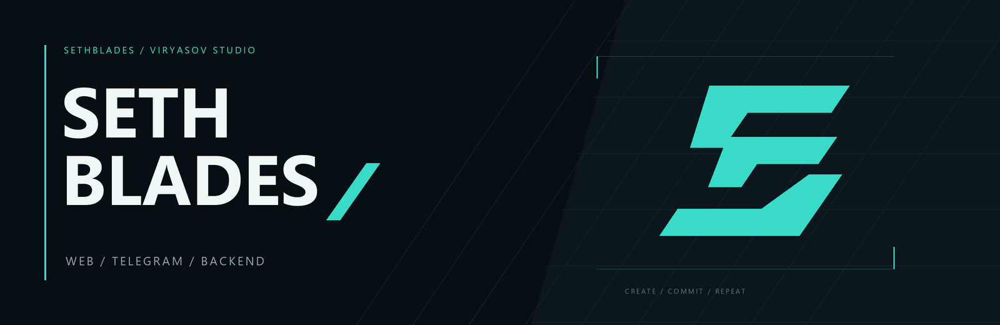
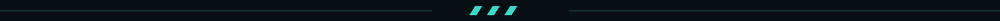

  

### Сайты, Telegram-боты и бэкенд для бизнеса.

[**Студия Viryasov ↗**](https://viryasov.com/)

[Репозитории](https://github.com/SethBlades?tab=repositories) · [Активность](https://github.com/SethBlades?tab=overview)

### Чем занимаюсь

- **Веб-разработка** — сайты и лендинги для бизнеса, личные кабинеты и админки.
- **Telegram** — боты и Mini Apps.
- **Бэкенд** — API, интеграции и автоматизация.

### Технологии

**Frontend**

  
  
  
  
  
  

**Backend**

  
  
  

**Infrastructure**

  
  
  

  

CREATE / COMMIT / REPEAT

